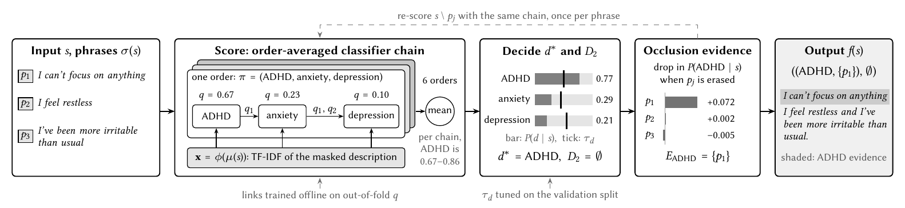
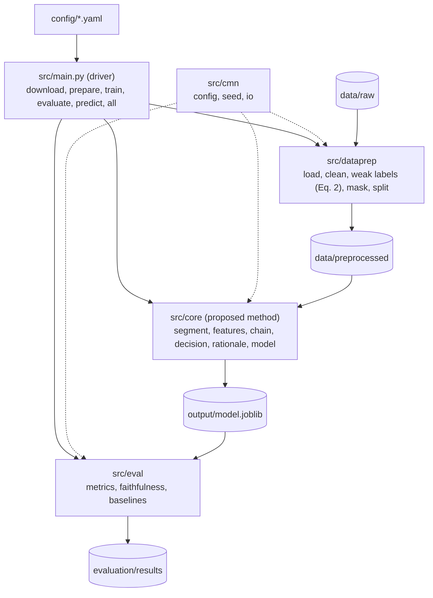

# Which Condition Fits? Multi-Label Diagnosis with Supporting Evidence from Symptom Description

**CoRE** (*Co-occurring condition classification with Rationale Extraction*) takes a self-reported
description of symptoms and returns (i) the condition that fits it best, (ii) any other conditions that
are also consistent with it, and (iii) for every predicted condition, the phrases of the description
that support it. The target conditions are ADHD, anxiety, and depression, which share symptoms such as
inattention, restlessness, and irritability and are often confused with one another.

> CSC 503 × SENG 474 Data Mining (Fall 2026), University of Victoria. Research prototype only; it is
> **not** a diagnostic tool and must not be used for clinical decisions.

## 1. Overview

| Stage | What it does | Code |
|---|---|---|
| Weak multi-label supervision | label = source community ∪ conditions the writer reports a diagnosis of ("I was also diagnosed with anxiety"); negated, hedged, and third-party statements are ignored | `src/dataprep/lexicon.py`, `src/dataprep/prepare.py` |
| Name masking | replaces *ADHD / anxiety / depression* (not symptom words such as "anxious") with a mask | `src/dataprep/lexicon.py` |
| Phrase segmentation σ | splits a description into clause-level phrases p₁…pₙ | `src/core/segment.py` |
| Representation φ | TF-IDF over word uni- and bigrams formed between masks, so a condition name never becomes a feature | `src/core/features.py` |
| Order-averaged classifier chain | logistic-regression chain for each of the k! = 6 label orders, trained on out-of-fold predecessor probabilities, averaged | `src/core/chain.py` |
| Decision rule | primary d* = argmax P(d\|s); secondary = other conditions with P(d\|s) ≥ τ_d (τ tuned for F1 on validation) | `src/core/decision.py` |
| Occlusion rationales | Δ_d(p_j) = P(d\|s) − P(d\|s without p_j); evidence = top ⌈n/2⌉ phrases with Δ > 0.01 | `src/core/rationale.py` |

## 2. Illustrative sample

<p align="center">
  <a href="docs/figures/core_pipeline.png">
    
  </a>
</p>

*Figure 1 of the report: the running example from our proposal passes through every stage. The chain
box unrolls one of the six label orders π; the dashed loop re-scores the description with each phrase
erased (occlusion). Every number is produced by `python scripts/figure1_values.py`. If the image does not
load, open [`docs/figures/core_pipeline.png`](docs/figures/core_pipeline.png) directly.*

```text
$ python -m src.main predict --config config/quickstart.yaml \
    --text "I can't focus on anything, I feel restless and I've been more irritable than usual."
  p1 = "I can't focus on anything"
  p2 = "I feel restless"
  p3 = "I've been more irritable than usual"
  P(d|s) = adhd: 0.7655, anxiety: 0.2893, depression: 0.2107
  f(s) = ((adhd, {p1}), {})
```

ADHD is the primary condition and phrase p1 is its evidence (erasing it lowers P(ADHD) by 0.07).
Anxiety and depression stay below their thresholds (0.45 and 0.55), so no secondary condition is
reported. Add `--json` to see the occlusion drop of every phrase for every condition.

## 3. Data

**Quickstart sample (bundled):** `data/raw/reddit_public_sample.csv`, 1,786 public Reddit posts already
published by other researchers on GitHub. Columns: `subreddit`, `post` (title and body), `source`.

| Community | Posts | Source (pinned commit) | Licence of the source repository |
|---|---|---|---|
| r/ADHD | 973 | [premDelaprem/subbreddit-classification](https://github.com/premDelaprem/subbreddit-classification) @ `aa08428` (1,000 most recent posts as of 1/5/2024, per its README) | MIT |
| r/Anxiety | 407 | [rishav-dev/MentalHealthResearch-SocialMedia](https://github.com/rishav-dev/MentalHealthResearch-SocialMedia) @ `ce62d48` (collected with PRAW; its dated file covers 20–25 September 2025) | none stated |
| r/depression | 406 | same as above | none stated |

User names and e-mail addresses are removed, and no post IDs, URLs, or scores are kept;
`python scripts/build_public_sample.py` rebuilds the file from the pinned commits. The posts belong to
their Reddit authors and are used here for research and teaching only. **Caveat:** r/ADHD and the other
two communities come from different collections, so a classifier can partly learn collection
differences; treat quickstart scores as indicative.

**Full dataset (downloaded):** Reddit Mental Health Dataset (Low et al., 2020),
[Zenodo 10.5281/zenodo.3941387](https://doi.org/10.5281/zenodo.3941387), ODC PDDL 1.0. We use the 2019
files of r/ADHD, r/Anxiety, and r/depression, which come from one collection. They are not committed;
`bash scripts/download_data.sh` fetches them (about 170 MB).

## 4. Prerequisites

* **Python 3.10 or newer.** Python 3.12 or 3.13 is recommended: only they can install the exact versions in
  `requirements-lock.txt`, which reproduce the reported numbers and hashes bit for bit. Python 3.10/3.11 use
  the compatible versions in `requirements.txt`; everything runs, and the last decimals may differ.
* **bash**: Linux, macOS, WSL, or Git Bash on Windows (Windows without bash: see Section 6.1).
* On Ubuntu/Debian/WSL the `venv` module is a separate package: `sudo apt install python3-venv`.
* About 200 MB of disk for the optional full dataset. No GPU is needed.

## 5. Installation

All code, `requirements*.txt` and `config/` live in **`proposed-solution/`**; run every command below from
that folder. (The quick-start scripts in Section 6 do all of this for you, from any folder.)

```bash
git clone https://github.com/eduardokdp/Which-Condition-Fits-.git
cd Which-Condition-Fits-/proposed-solution
python3 -m venv .venv
source .venv/bin/activate                 # Windows: .venv\Scripts\activate
pip install -r requirements-lock.txt      # Python 3.12/3.13: exact versions (reported hashes)
# or, on Python 3.10/3.11:
pip install -r requirements.txt -r requirements-viz.txt
```

Conda alternative: `conda env create -f environment.yml && conda activate core-diagnosis` (Python 3.13, exact versions).

## 6. Quick start

```bash
cd Which-Condition-Fits-/proposed-solution
bash quickstart.sh
```

The repository root has a `quickstart.sh` shortcut too, so `bash quickstart.sh` also works from there; the script
always runs inside `proposed-solution/`. It picks a Python (3.13 or 3.12 if available), creates `proposed-solution/.venv` (or reuses an existing one), installs the packages, runs the 26
unit, protocol and reproducibility tests, runs
`prepare → train → evaluate → predict` on the bundled sample (about a minute on a laptop), and checks
that the predictions hash equals `evaluation/results/quickstart/EXPECTED_SHA256`. On Windows:

```bash
python -m unittest discover -s tests -t .
python -m src.main all --config config/quickstart.yaml
```

Full run: `bash scripts/download_data.sh`, then `python -m src.main all --config config/default.yaml`.

**Figures and visual report.** After a run, draw the evaluation figures and a one-page report:

```bash
pip install -r requirements-viz.txt
python scripts/make_figures.py --config config/quickstart.yaml
```

This writes eight figures to `evaluation/results/quickstart/figures/{dark,light}/` (method comparison with
confidence intervals, other multi-label metrics, per-condition scores, confusion matrices, predicted
probabilities against the thresholds, rationale faithfulness, phrase-level occlusion for the two demo
descriptions, label counts per split) and `evaluation/results/quickstart/REPORT.md`, which shows them
together (in VS Code: open the file and click *Open Preview*).

| Command | Output |
|---|---|
| `python -m src.main download --config …` | `data/raw/*.csv` (full dataset only) |
| `python -m src.main prepare --config …` | `data/preprocessed/<run>/{train,val,test}.csv`, `data_card.json` |
| `python -m src.main train --config …` | `output/<run>/model.joblib`, `thresholds.json` |
| `python -m src.main evaluate --config …` | `evaluation/results/<run>/metrics.{json,csv}`, `evaluation/ground_truth/<run>/test_labels.csv` |
| `python -m src.main predict --config … --text "…"` (or `--input file.csv`) | f(s) in the report's notation; JSON with `--json` |
| `python -m src.main all --config …` | all of the above |
| `python scripts/make_figures.py --config …` | `evaluation/results/<run>/figures/`, `REPORT.md` (needs `requirements-viz.txt`) |

### 6.1 Running in VS Code (Windows, macOS, Linux)

The repository includes a VS Code workspace, `CoRE.code-workspace`, with ready-made tasks, so the whole
pipeline runs from the menus without typing commands. The Milestone 3 tasks were tested from a fresh copy on
Windows 11 (Python 3.12.10) and on Linux (Python 3.13), with the predictions hash matching `EXPECTED_SHA256` on
both; the Milestone 4 additions were tested on Linux (Python 3.13).

**You need**

* [VS Code](https://code.visualstudio.com/) with the **Python** extension (`ms-python.python`; VS Code
  suggests it when you open the workspace).
* **Python 3.12 or 3.13** (recommended; 3.10+ works) on your PATH. Check in a terminal: `py -3 --version` or `python --version`
  (Windows), `python3 --version` (macOS/Linux). On Windows, install from
  [python.org](https://www.python.org/downloads/) and tick **Add python.exe to PATH**.
* **Git**, only for cloning and for the optional *Rebuild Reddit sample* task.
* Internet access the first time, to install the packages (about 80 MB of downloads).

**Steps**

1. **Get the code:** `git clone https://github.com/eduardokdp/Which-Condition-Fits-.git`
   (or *Code → Download ZIP* on GitHub and extract it).
2. **Open the workspace:** in VS Code choose *File → Open Workspace from File…* and select
   `CoRE.code-workspace` in the `proposed-solution` folder. If you opened the folder instead, click
   **Open Workspace** in the notification VS Code shows. If VS Code asks whether you trust the
   authors, choose **Yes** (tasks do not run in Restricted Mode).
3. **Set up once:** *Terminal → Run Task… → **Setup: create .venv and install requirements***.
   This creates `.venv` inside `proposed-solution/` and installs the exact versions from
   `requirements-lock.txt` (or, on Python 3.10/3.11, the compatible ones from `requirements.txt` plus matplotlib). It is done when the last line reads `Successfully installed …`.
   On Windows the Setup terminal shows a ⚠ icon; it only means VS Code's shell integration does not
   support `cmd.exe` and is not an error.
4. **Run everything:** *Terminal → Run Build Task…* (`Ctrl+Shift+B`, macOS `Cmd+Shift+B`) starts
   **Quickstart: run everything**: unit tests → pipeline → reproducibility check → figures, each in
   its own terminal tab on the right of the Terminal panel (about one minute). Every tab gets a ✓ when
   it succeeds.
5. **See the results:** open `evaluation/results/quickstart/REPORT.md`. It opens as a rendered preview
   with all eight figures (for any other Markdown file, press `Ctrl+Shift+V`).

**Expected output** (quickstart sample, seed 42)

| Task | What you should see |
|---|---|
| Unit tests | `Ran 26 tests … OK` |
| Pipeline | train / val / test = 735 / 157 / 158 posts; thresholds ADHD 0.50, anxiety 0.45, depression 0.55; CoRE micro-F1 0.6514, macro-F1 0.6561 |
| Reproducibility check | `Reproducibility check PASSED: 6371861ba7936c0880573caa24c5d576f5e386f477e7faf863195b69189f0aa5` |
| Figures and REPORT.md | `figures: …/evaluation/results/quickstart/figures` and `report: …/REPORT.md` |

**All tasks** (*Terminal → Run Task…*)

| Task | Runs | Writes |
|---|---|---|
| Setup: create .venv and install requirements | `python -m venv .venv`, `pip install -r requirements-lock.txt` (falls back to `requirements.txt` + `requirements-viz.txt`) | `.venv/` |
| Quickstart: run everything | the four tasks below, in order | everything below |
| Milestone 4: run everything | experiment, figures, report tables (Section 7.1) | `evaluation/results/m4_sample/`, `../experiments/tables/` |
| Unit tests | `python -m unittest discover -s tests -t . -v` | — |
| Pipeline: prepare, train, evaluate, predict | `python -m src.main all --config config/quickstart.yaml` | `data/preprocessed/`, `output/`, `evaluation/` |
| Reproducibility check (predictions hash) | compares `metrics.json` with `EXPECTED_SHA256` | — |
| Figures and REPORT.md | `python scripts/make_figures.py --config config/quickstart.yaml` | `evaluation/results/quickstart/figures/`, `REPORT.md` |
| Stage: prepare data / train / evaluate | `python -m src.main prepare` / `train` / `evaluate` | one stage at a time |
| Predict: running example (JSON) | `python -m src.main predict --json` | `output/quickstart/demo_prediction.json` |
| Predict: my own description | asks for a description, then `python -m src.main predict --text "…"` | `output/quickstart/demo_prediction.json` |
| Figure 1 values | `python scripts/figure1_values.py` | — (prints the numbers in Figure 1) |
| Rebuild Reddit sample from GitHub | `python scripts/build_public_sample.py` (needs Git) | `data/raw/rebuilt_public_sample.csv` (git-ignored copy) |

**Without the VS Code tasks (any terminal, from the `proposed-solution` folder)**

Windows (PowerShell or Command Prompt). Calling `.venv\Scripts\python` directly avoids the
execution-policy error that `Activate.ps1` can raise:

```powershell
py -3 -m venv .venv                     # or: python -m venv .venv
.venv\Scripts\python -m pip install -r requirements-lock.txt   # Python 3.10/3.11: -r requirements.txt -r requirements-viz.txt
.venv\Scripts\python -m unittest discover -s tests -t . -v
.venv\Scripts\python -m src.main all --config config/quickstart.yaml
.venv\Scripts\python scripts/make_figures.py --config config/quickstart.yaml
```

macOS / Linux / WSL (or simply `bash quickstart.sh`):

```bash
python3 -m venv .venv
.venv/bin/python -m pip install -r requirements-lock.txt   # Python 3.10/3.11: -r requirements.txt -r requirements-viz.txt
.venv/bin/python -m unittest discover -s tests -t . -v
.venv/bin/python -m src.main all --config config/quickstart.yaml
.venv/bin/python scripts/make_figures.py --config config/quickstart.yaml
```

**Troubleshooting**

| Problem | Fix |
|---|---|
| *Run Task* lists no CoRE tasks | You opened the folder, not the workspace: *File → Open Workspace from File… → `CoRE.code-workspace`*. |
| `python is not recognized`, or the Microsoft Store opens | Install Python from python.org with **Add python.exe to PATH** ticked, then restart VS Code. |
| A task fails with `.venv\Scripts\python.exe` (or `.venv/bin/python`) not found | Run **Setup** first. |
| `No matching distribution found for numpy==…` | `requirements-lock.txt` needs Python 3.12 or 3.13. On 3.10/3.11 run `pip install -r requirements.txt -r requirements-viz.txt` (the scripts do this automatically). |
| `The virtual environment was not created successfully because ensurepip is not available` | Ubuntu/Debian/WSL: `sudo apt install python3-venv` (or `python3.X-venv`), delete the half-made `.venv`, rerun. |
| `bash: quickstart.sh: No such file or directory` | Run it from the repository root or from `proposed-solution/`; both folders contain `quickstart.sh`. |
| `$'\r': command not found` | The scripts were checked out with Windows line endings. The repository's `.gitattributes` prevents this on a fresh clone; otherwise run `sed -i 's/\r$//' *.sh scripts/*.sh`. |
| `Reproducibility check: hash differs` | Expected unless the exact versions were installed: compare `python -m pip list` with `requirements-lock.txt` (Python 3.12/3.13). Line endings do not matter: every output file is written with LF. |
| `Activate.ps1 cannot be loaded because running scripts is disabled` | Use the tasks, or call `.venv\Scripts\python` directly as shown above. |
| *Rebuild Reddit sample* says `git was not found on PATH` | Install [Git](https://git-scm.com/) and restart VS Code. |
| First run on Windows is slow | Antivirus scans the new `.venv` once; later runs are faster. |

### 6.2 Team responsibilities (Milestone 3)

Each member writes one part of Section 3 of the report and owns the code files that belong to it
(5 to 7 files each). The empty `__init__.py` files go with their folder.

| Member | Report part | Code files | Other work |
|---|---|---|---|
| Niyaaz Baines | 3.1 Formal definition | 7: `src/dataprep/load.py`, `src/dataprep/prepare.py`, `src/core/segment.py`, `src/cmn/config.py`, `config/quickstart.yaml`, `config/default.yaml`, `scripts/build_public_sample.py` | Abstract, Introduction |
| Eduardo Kallina de Paula | 3.2 Algorithm | 6: `src/dataprep/lexicon.py`, `src/core/features.py`, `src/core/chain.py`, `src/core/decision.py`, `src/core/rationale.py`, `src/core/model.py` | References |
| Thiago Vasconcelos Pinheiro Lopes | 3.3 Pseudo-code | 6: `src/main.py`, `src/cmn/seed.py`, `src/eval/evaluate.py`, `src/eval/metrics.py`, `src/eval/baselines.py`, `tests/test_core.py` | Implementation section |
| Priyanshkumar Ghanshyambhai Patel | 3.4 Figure | 5: `scripts/figure1_values.py`, `scripts/make_figures.py`, `src/cmn/io.py`, `quickstart.sh`, `scripts/download_data.sh` | README, final PDF and submission zip, GitHub push |

## 7. Results

Quickstart run: 1,050 posts (350 per community), split 735 / 157 / 158, seed 42; 11% of the posts carry
two or more labels. Test set of 158 posts, with seeded bootstrap 95% confidence intervals:

| Method | micro-F1 (95% CI) | macro-F1 (95% CI) | Hamming loss | subset accuracy | recall on multi-label posts |
|---|---|---|---|---|---|
| **CoRE (order-averaged chain)** | 0.651 (0.600–0.702) | 0.656 (0.603–0.710) | 0.289 | 0.418 | 0.600 |
| Ablation: binary relevance | 0.643 (0.595–0.694) | 0.649 (0.597–0.701) | 0.316 | 0.348 | 0.629 |
| Baseline: single-label | 0.641 (0.580–0.707) | 0.641 (0.579–0.705) | 0.253 | 0.582 | 0.429 |

* The paired bootstrap difference in micro-F1 is +0.009 (−0.016 to +0.030) against binary relevance and
  +0.011 (−0.038 to +0.060) against single-label: **no method is reliably better on this small sample.**
  The single-label baseline has the best subset accuracy because most posts carry one label.
* Rationale faithfulness (ERASER): deleting CoRE's evidence lowers the predicted probability by 0.121
  (comprehensiveness) against 0.019 for the same number of random phrases; the evidence alone keeps the
  prediction (sufficiency −0.084, against +0.069 for random phrases).

Milestone 4 (Section 7.1) replaces this single split with 5-fold cross-validation, a hyperparameter grid and six baselines.

### 7.1 Milestone 4: cross-validated evaluation

Report: [`../experiments/4_Evaluation_Niyaaz_Eduardo_Thiago_Priyansh.pdf`](../experiments/). One command
reproduces every number, table and figure in it (about 3 minutes on a laptop):

```bash
bash reproduce_m4.sh                    # from the repository root or proposed-solution/ (= bash scripts/reproduce_m4.sh)
                                        # setup -> 26 tests -> experiment -> hash check -> figures -> report tables
# or step by step:
python -m src.main experiment --config config/m4_sample.yaml
python scripts/make_m4_figures.py --results evaluation/results/m4_sample
python scripts/make_m4_tables.py  --results evaluation/results/m4_sample --out ../experiments/tables
```

**Protocol** (`src/eval/protocol.py`, saved to `protocol.csv`). One 80/20 dev/test split stratified on
the label set (seed 42); five stratified folds on the dev set, computed once and used by every method and
configuration; in each round, features and model are fitted on the training folds minus a stratified 15%
that is used only to tune the per-condition thresholds. The configuration with the best mean CV macro-F1
is refitted on the dev set and evaluated once on the test set. `tests/test_m4.py` checks that no test post
is used in any fit or tuning step, that every method sees the same folds, and that reruns are identical.

**Methods** (`src/eval/registry.py`): CoRE, multiclass logistic regression (one condition per post),
binary relevance, a single-order classifier chain, k-NN (cosine), linear SVM and Complement Naive Bayes.
All share the same masked TF-IDF features and, if multi-label, CoRE's decision rule. Grids are in
`config/m4_sample.yaml` (68 configurations, 340 fits).

**Results** on the bundled sample (1,050 posts; 840 dev, 210 test; 95% bootstrap intervals):

| Method | Selected setting | Macro-F1 (95% CI) | Macro AUC | Micro-F1 | Hamming loss | Recall on multi-condition posts |
|---|---|---|---|---|---|---|
| **CoRE** | C = 3, unigrams, out-of-fold inputs | **0.755** (0.715–0.790) | **0.865** | **0.750** | 0.211 | 0.766 |
| Multiclass LR | C = 10, unigrams | 0.727 (0.674–0.778) | 0.863 | 0.725 | **0.194** | 0.447 |
| Binary relevance | C = 3, uni+bigrams | 0.732 (0.677–0.778) | 0.854 | 0.731 | 0.213 | 0.723 |
| Chain (1 order) | C = 3, unigrams | 0.737 (0.696–0.771) | 0.857 | 0.730 | 0.237 | **0.787** |
| Linear SVM | C = 10 | 0.733 (0.684–0.775) | 0.855 | 0.730 | 0.221 | 0.723 |
| Naive Bayes | α = 0.1 | 0.686 (0.638–0.728) | 0.831 | 0.682 | 0.270 | 0.638 |
| k-NN | k = 15 | 0.630 (0.577–0.680) | 0.778 | 0.632 | 0.303 | 0.702 |

CoRE's lead over the multiclass model, binary relevance, the single-order chain and the SVM is not
significant (paired bootstrap intervals include zero); it is significantly better than Naive Bayes and
k-NN. Its advantage comes from posts with several conditions (macro-F1 0.835 vs 0.612 for the multiclass
model), at the cost of predicting anxiety with depression too often. Full outputs:

| File in `evaluation/results/m4_sample/` | Content |
|---|---|
| `data_card.json` | dataset statistics and posts removed by each cleaning step |
| `protocol.csv` | dev/test part, fold and threshold-part membership of every post |
| `cv_results.csv`, `cv_summary.csv` | every (method, configuration, fold) score; means, s.d. and the selected setting |
| `best_params.json` | selected configuration per method |
| `test_predictions.csv` | scores and decisions of every method on the test posts |
| `test_metrics.json`, `test_metrics.csv` | metrics, bootstrap intervals, paired differences, confusion matrices, subgroups, timing |
| `EXPECTED_SHA256` | hash of `test_predictions.csv` for the reported run |
| `figures/` | `rq2_sensitivity` (Figure 1) and `label_set_confusion` (Figure 2), PDF and PNG |

**Second dataset.** `config/m4_rmhd.yaml` runs the same experiment on the Reddit Mental Health Dataset
(Low et al., 2020; 3,000 posts per community). Download the three 2019 files first
(`bash scripts/download_data.sh`, about 168 MB, not committed); `scripts/reproduce_m4.sh` then runs it
automatically. It was not part of the submitted report.

**Reproducibility (Milestone 3).** Every random operation is seeded from `seed` in the config (`src/cmn/seed.py`,
splits, cross-fitting folds, bootstrap, random rationales), package versions are pinned, and the
evaluation writes the SHA-256 of its predictions. With the same data, code, config, seed, and package
versions, a rerun gives `6371861ba7936c0880573caa24c5d576f5e386f477e7faf863195b69189f0aa5`; other
operating systems or maths libraries can change the last decimal of a probability and therefore the hash.

## 8. Repository structure

A driver, three stage packages that mirror Section 3 of the report, and a shared common layer:



```text
.
├── README.md  LICENSE  .gitignore  environment.yml
├── requirements.txt  requirements-viz.txt   compatible versions (Python 3.10+)
├── requirements-lock.txt                  exact versions of the reported runs (Python 3.12/3.13)
├── quickstart.sh                         Milestone 3 quick start (Section 6)
├── reproduce_m4.sh                       Milestone 4 reproduction (Section 7.1; shortcut to scripts/reproduce_m4.sh)
├── CoRE.code-workspace  VS Code workspace with ready-made tasks (Section 6.1)
├── config/            default.yaml (full dataset), quickstart.yaml (bundled sample),
│                      m4_sample.yaml and m4_rmhd.yaml (Milestone 4 experiments)
├── data/raw/          reddit_public_sample.csv; downloaded files land here (git-ignored)
├── data/preprocessed/ splits and data card (generated)
├── src/               main.py, cmn/, dataprep/, core/, eval/ (Milestone 4: protocol, registry,
│                      m4_metrics, experiment)
├── evaluation/        ground_truth/ and results/ (quickstart: Milestone 3; m4_sample: Milestone 4)
├── output/            trained models (generated)
├── scripts/           quickstart.sh, reproduce_m4.sh, _env.sh (shared setup), download_data.sh, build_public_sample.py,
│                      figure1_values.py, make_figures.py, make_m4_figures.py, make_m4_tables.py
├── tests/             unit and reproducibility tests (test_core.py, test_m4.py)
├── docs/figures/      Figure 1 of the report
└── main.tex, 3_Solution_*.pdf   Milestone 3 report (the Milestone 4 report is in ../experiments/)
```

## 9. Team

| Name | Milestone 1: Proposal | Milestone 2: Literature Review | Milestone 3: Proposed Solution | Milestone 4: Evaluation |
|---|---|---|---|---|
| Niyaaz Baines | Problem definition (1.1) | History, Abstract | Formal definition (3.1), abstract, introduction | Research questions (4.2), introduction |
| Eduardo Kallina de Paula | Motivation, motivating example, gaps in existing solutions (1.2–1.2.2) | Introduction, Positioning | Algorithm (3.2), references | Baselines (4.4) |
| Thiago Vasconcelos Pinheiro Lopes | Formal problem definition, running example (1.3–1.3.1) | Hierarchy, Taxonomy | Pseudo-code (3.3), implementation section | Benchmark dataset (4.3) |
| Priyanshkumar Ghanshyambhai Patel (lead) | Abstract | Comparative Analysis, Table | Figure 1 (3.4), README, submission | Evaluation strategy and metrics (4.5), experiments, results, submission |

## 10. Citation

```bibtex
@misc{baines2026whichcondition,
  title  = {Which Condition Fits? Multi-Label Diagnosis with Supporting Evidence from Symptom Description},
  author = {Baines, Niyaaz and Kallina de Paula, Eduardo and Vasconcelos Pinheiro Lopes, Thiago and Patel, Priyanshkumar Ghanshyambhai},
  year   = {2026},
  howpublished = {\url{https://github.com/eduardokdp/Which-Condition-Fits-}},
  note   = {CSC 503 / SENG 474 course project, University of Victoria}
}
```

## 11. License

Code: MIT (`LICENSE`). Data: see Section 3; each source keeps its own terms.

**Use of generative AI.** Following the course's Level D guideline, parts of the code and documentation
were drafted with Claude (Anthropic) and then reviewed, run, and tested by the team.
