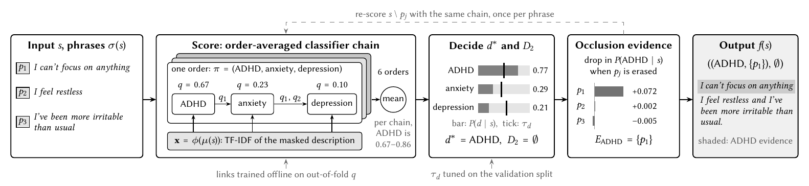
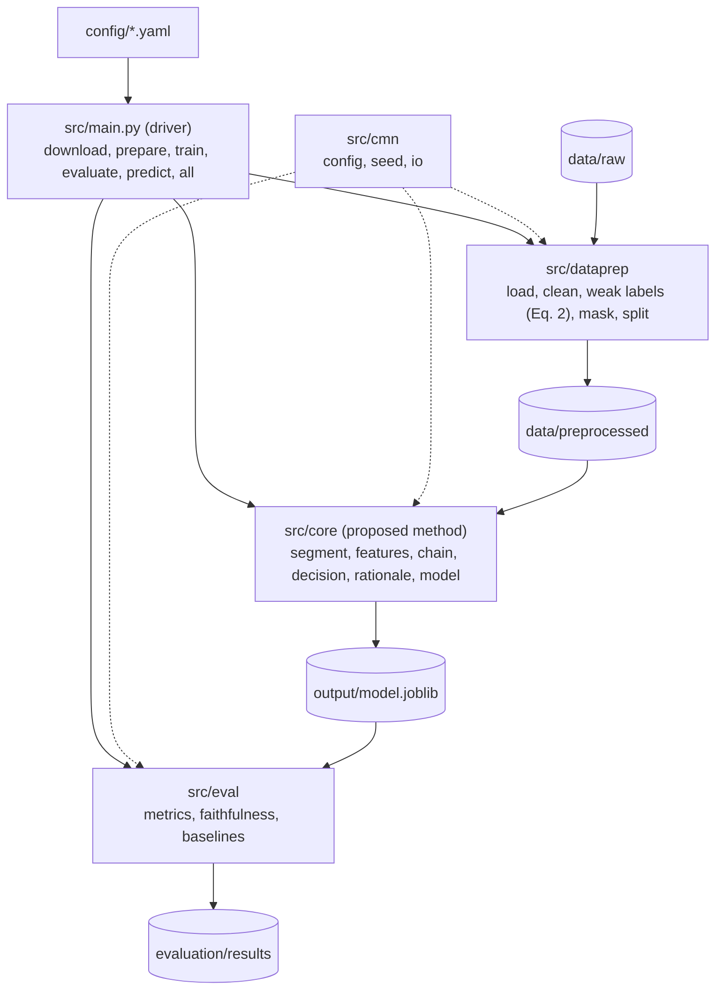

# Which Condition Fits? Multi-Label Diagnosis with Supporting Evidence from Symptom Description

**CoRE** (*Co-occurring condition classification with Rationale Extraction*) takes a self-reported
description of symptoms and returns (i) the condition that fits it best, (ii) any other conditions that
are also consistent with it, and (iii) for every predicted condition, the phrases of the description
that support it. The target conditions are ADHD, anxiety, and depression, which share symptoms such as
inattention, restlessness, and irritability and are often confused with one another.

> CSC 503 × SENG 747 Data Mining (Fall 2026), University of Victoria. Research prototype only; it is
> **not** a diagnostic tool and must not be used for clinical decisions.

## 1. Overview

| Stage | What it does | Code |
|---|---|---|
| Weak multi-label supervision | label = source community ∪ conditions the writer reports a diagnosis of ("I was also diagnosed with anxiety"); negated, hedged, and third-party statements are ignored | `src/dataprep/lexicon.py`, `src/dataprep/prepare.py` |
| Name masking | replaces *ADHD / anxiety / depression* (not symptom words such as "anxious") with a mask | `src/dataprep/lexicon.py` |
| Phrase segmentation σ | splits a description into clause-level phrases p₁…pₙ | `src/core/segment.py` |
| Representation φ | TF-IDF over word uni- and bigrams formed between masks, so a condition name never becomes a feature | `src/core/features.py` |
| Order-averaged classifier chain | logistic-regression chain for each of the k! = 6 label orders, trained on out-of-fold predecessor probabilities, averaged | `src/core/chain.py` |
| Decision rule | primary d* = argmax P(d\|s); secondary = other conditions with P(d\|s) ≥ τ_d (τ tuned for F1 on validation) | `src/core/decision.py` |
| Occlusion rationales | Δ_d(p_j) = P(d\|s) − P(d\|s without p_j); evidence = top ⌈n/2⌉ phrases with Δ > 0.01 | `src/core/rationale.py` |

## 2. Illustrative sample



*Figure 1 of the report: the running example from our proposal passes through every stage. The chain
box unrolls one of the six label orders π; the dashed loop re-scores the description with each phrase
erased (occlusion). Every number is produced by `python scripts/figure1_values.py`.*

```text
$ python -m src.main predict --config config/quickstart.yaml \
    --text "I can't focus on anything, I feel restless and I've been more irritable than usual."
  p1 = "I can't focus on anything"
  p2 = "I feel restless"
  p3 = "I've been more irritable than usual"
  P(d|s) = adhd: 0.7655, anxiety: 0.2893, depression: 0.2107
  f(s) = ((adhd, {p1}), {})
```

ADHD is the primary condition and phrase p1 is its evidence (erasing it lowers P(ADHD) by 0.07).
Anxiety and depression stay below their thresholds (0.45 and 0.55), so no secondary condition is
reported. Add `--json` to see the occlusion drop of every phrase for every condition.

## 3. Data

**Quickstart sample (bundled):** `data/raw/reddit_public_sample.csv`, 1,786 public Reddit posts already
published by other researchers on GitHub. Columns: `subreddit`, `post` (title and body), `source`.

| Community | Posts | Source (pinned commit) | Licence of the source repository |
|---|---|---|---|
| r/ADHD | 973 | [premDelaprem/subbreddit-classification](https://github.com/premDelaprem/subbreddit-classification) @ `aa08428` (1,000 most recent posts as of 1/5/2024, per its README) | MIT |
| r/Anxiety | 407 | [rishav-dev/MentalHealthResearch-SocialMedia](https://github.com/rishav-dev/MentalHealthResearch-SocialMedia) @ `ce62d48` (collected with PRAW; its dated file covers 20–25 September 2025) | none stated |
| r/depression | 406 | same as above | none stated |

User names and e-mail addresses are removed, and no post IDs, URLs, or scores are kept;
`python scripts/build_public_sample.py` rebuilds the file from the pinned commits. The posts belong to
their Reddit authors and are used here for research and teaching only. **Caveat:** r/ADHD and the other
two communities come from different collections, so a classifier can partly learn collection
differences; treat quickstart scores as indicative.

**Full dataset (downloaded):** Reddit Mental Health Dataset (Low et al., 2020),
[Zenodo 10.5281/zenodo.3941387](https://doi.org/10.5281/zenodo.3941387), ODC PDDL 1.0. We use the 2019
files of r/ADHD, r/Anxiety, and r/depression, which come from one collection. They are not committed;
`bash scripts/download_data.sh` fetches them (about 170 MB).

## 4. Prerequisites

Python 3.13 (exact pinned environment) and about 200 MB of disk for the full dataset. No GPU is needed.

## 5. Installation

```bash
git clone https://github.com/eduardokdp/Data-Mining-Diagnosis.git
cd Data-Mining-Diagnosis
python -m venv .venv
source .venv/bin/activate          # Windows: .venv\Scripts\activate
pip install -r requirements.txt    # or: conda env create -f environment.yml && conda activate core-diagnosis
```

If your Python cannot install the pinned versions, `pip install numpy scipy pandas scikit-learn joblib PyYAML`
also works, but the last decimals of the results (and the predictions hash) may differ.

## 6. Quick start

```bash
bash quickstart.sh
```

The script installs the requirements, runs the 17 unit and reproducibility tests, runs
`prepare → train → evaluate → predict` on the bundled sample (about a minute on a laptop), and checks
that the predictions hash equals `evaluation/results/quickstart/EXPECTED_SHA256`. On Windows:

```bash
python -m unittest discover -s tests -t .
python -m src.main all --config config/quickstart.yaml
```

Full run: `bash scripts/download_data.sh`, then `python -m src.main all --config config/default.yaml`.

| Command | Output |
|---|---|
| `python -m src.main download --config …` | `data/raw/*.csv` (full dataset only) |
| `python -m src.main prepare --config …` | `data/preprocessed/<run>/{train,val,test}.csv`, `data_card.json` |
| `python -m src.main train --config …` | `output/<run>/model.joblib`, `thresholds.json` |
| `python -m src.main evaluate --config …` | `evaluation/results/<run>/metrics.{json,csv}`, `evaluation/ground_truth/<run>/test_labels.csv` |
| `python -m src.main predict --config … --text "…"` (or `--input file.csv`) | f(s) in the report's notation; JSON with `--json` |
| `python -m src.main all --config …` | all of the above |

## 7. Results

Quickstart run: 1,050 posts (350 per community), split 735 / 157 / 158, seed 42; 11% of the posts carry
two or more labels. Test set of 158 posts, with seeded bootstrap 95% confidence intervals:

| Method | micro-F1 (95% CI) | macro-F1 (95% CI) | Hamming loss | subset accuracy | recall on multi-label posts |
|---|---|---|---|---|---|
| **CoRE (order-averaged chain)** | 0.651 (0.600–0.702) | 0.656 (0.603–0.710) | 0.289 | 0.418 | 0.600 |
| Ablation: binary relevance | 0.643 (0.595–0.694) | 0.649 (0.597–0.701) | 0.316 | 0.348 | 0.629 |
| Baseline: single-label | 0.641 (0.580–0.707) | 0.641 (0.579–0.705) | 0.253 | 0.582 | 0.429 |

* The paired bootstrap difference in micro-F1 is +0.009 (−0.016 to +0.030) against binary relevance and
  +0.011 (−0.038 to +0.060) against single-label: **no method is reliably better on this small sample.**
  The single-label baseline has the best subset accuracy because most posts carry one label.
* Rationale faithfulness (ERASER): deleting CoRE's evidence lowers the predicted probability by 0.121
  (comprehensiveness) against 0.019 for the same number of random phrases; the evidence alone keeps the
  prediction (sufficiency −0.084, against +0.069 for random phrases).

Milestone 4 repeats this evaluation on the single-collection Reddit Mental Health Dataset.

**Reproducibility.** Every random operation is seeded from `seed` in the config (`src/cmn/seed.py`,
splits, cross-fitting folds, bootstrap, random rationales), package versions are pinned, and the
evaluation writes the SHA-256 of its predictions. With the same data, code, config, seed, and package
versions, a rerun gives `6371861ba7936c0880573caa24c5d576f5e386f477e7faf863195b69189f0aa5`; other
operating systems or maths libraries can change the last decimal of a probability and therefore the hash.

## 8. Repository structure

A driver, three stage packages that mirror Section 3 of the report, and a shared common layer:



```text
.
├── README.md  LICENSE  requirements.txt  environment.yml  quickstart.sh
├── config/            default.yaml (full dataset), quickstart.yaml (bundled sample)
├── data/raw/          reddit_public_sample.csv; downloaded files land here (git-ignored)
├── data/preprocessed/ splits and data card (generated)
├── src/               main.py, cmn/, dataprep/, core/, eval/
├── evaluation/        ground_truth/ and results/ of the quickstart run
├── output/            trained models (generated)
├── scripts/           download_data.sh, build_public_sample.py, figure1_values.py
├── tests/             unit and reproducibility tests
├── docs/figures/      Figure 1 of the report
└── proposed-solution/ Milestone 3 report (LaTeX and PDF)
```

## 9. Team

| Name | Milestone 1: Proposal | Milestone 2: Literature Review | Milestone 3: Proposed Solution |
|---|---|---|---|
| Niyaaz Baines | Problem definition (1.1) | History, Abstract | Abstract, introduction |
| Eduardo Kallina de Paula | Motivation, motivating example, gaps in existing solutions (1.2–1.2.2) | Introduction, Positioning | Repository, README, quickstart |
| Thiago Vasconcelos Pinheiro Lopes | Formal problem definition, running example (1.3–1.3.1) | Hierarchy, Taxonomy | Formal definition, Figure 1 |
| Priyanshkumar Ghanshyambhai Patel (lead) | Abstract | Comparative Analysis, Table | Method design, pseudo-code, implementation |

## 10. Citation

```bibtex
@misc{baines2026whichcondition,
  title  = {Which Condition Fits? Multi-Label Diagnosis with Supporting Evidence from Symptom Description},
  author = {Baines, Niyaaz and Kallina de Paula, Eduardo and Vasconcelos Pinheiro Lopes, Thiago and Patel, Priyanshkumar Ghanshyambhai},
  year   = {2026},
  howpublished = {\url{https://github.com/eduardokdp/Data-Mining-Diagnosis}},
  note   = {CSC 503 / SENG 747 course project, University of Victoria}
}
```

## 11. License

Code: MIT (`LICENSE`). Data: see Section 3; each source keeps its own terms.

**Use of generative AI.** Following the course's Level D guideline, parts of the code and documentation
were drafted with Claude (Anthropic) and then reviewed, run, and tested by the team.
