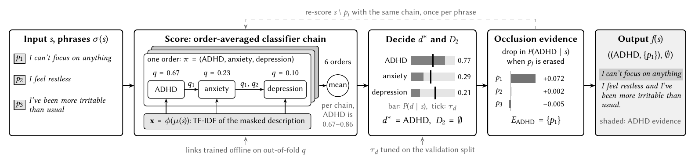
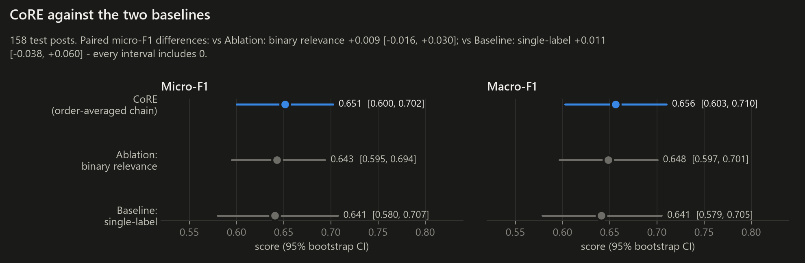
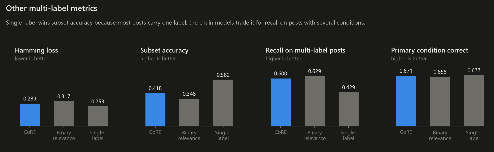
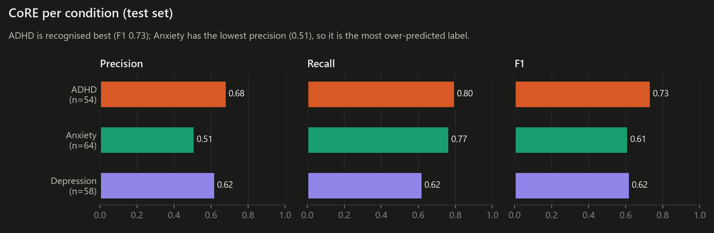
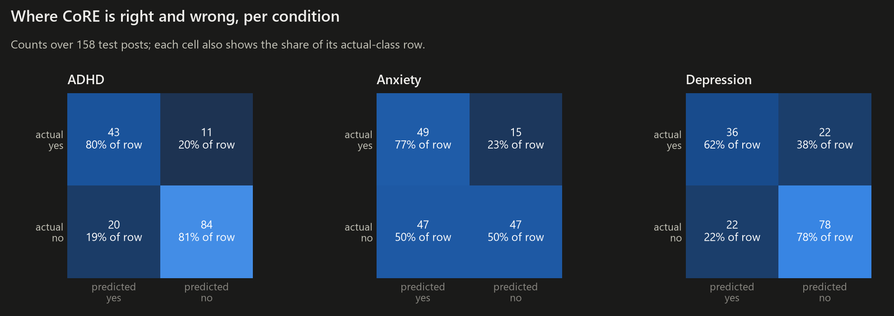
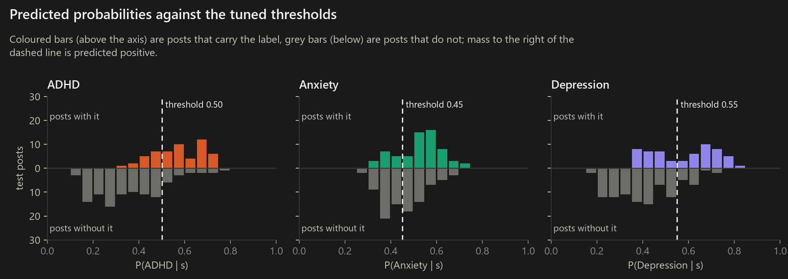
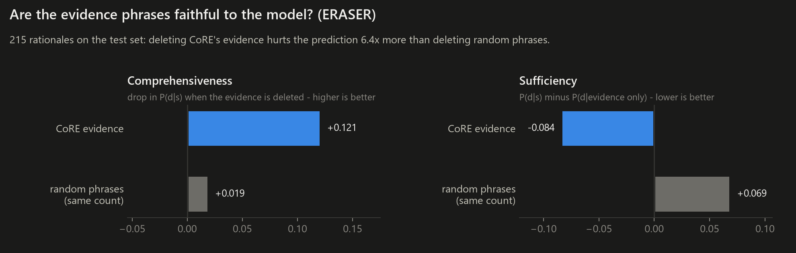
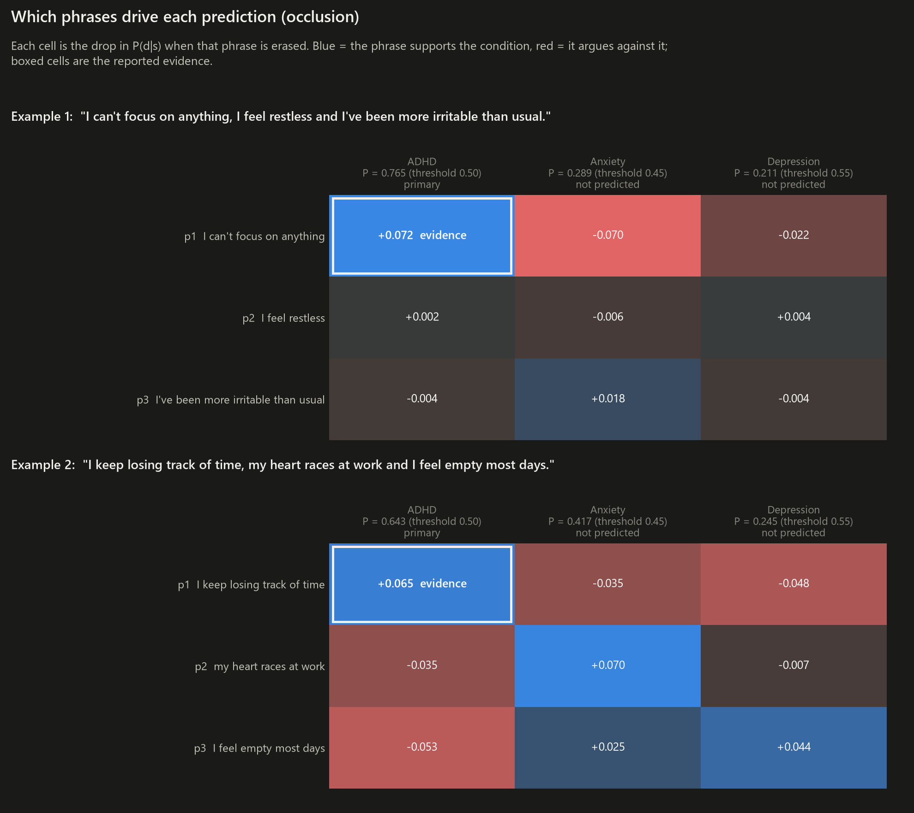
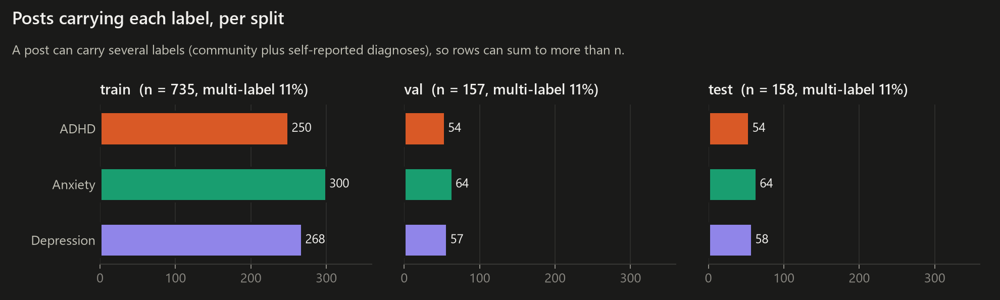

# CoRE results - `quickstart` run

**Reproducibility check: PASSED** - predictions match the reported run.

`6371861ba7936c0880573caa24c5d576f5e386f477e7faf863195b69189f0aa5`

Seed 42 | 735 / 157 / 158 posts (train / val / test) |
thresholds ADHD 0.50, Anxiety 0.45, Depression 0.55

| Method | micro-F1 (95% CI) | macro-F1 (95% CI) | Hamming loss | subset accuracy | recall on multi-label posts |
|---|---|---|---|---|---|
| **CoRE (order-averaged chain)** | 0.651 (0.600-0.702) | 0.656 (0.603-0.710) | 0.289 | 0.418 | 0.600 |
| Ablation: binary relevance | 0.643 (0.595-0.694) | 0.648 (0.597-0.701) | 0.317 | 0.348 | 0.629 |
| Baseline: single-label | 0.641 (0.580-0.707) | 0.641 (0.579-0.705) | 0.253 | 0.582 | 0.429 |

Rationale faithfulness: comprehensiveness 0.121 (random 0.019),
sufficiency -0.084 (random +0.069), over 215 rationales.

## Pipeline

## 1. CoRE against the baselines

## 2. Per-condition performance

## 3. Evidence phrases

## 4. Data

---
Generated by `python scripts/make_figures.py --config config/quickstart.yaml`.
Light-background versions of every figure are in `figures/light/` for the report and slides.
Research prototype only - not a diagnostic tool.
